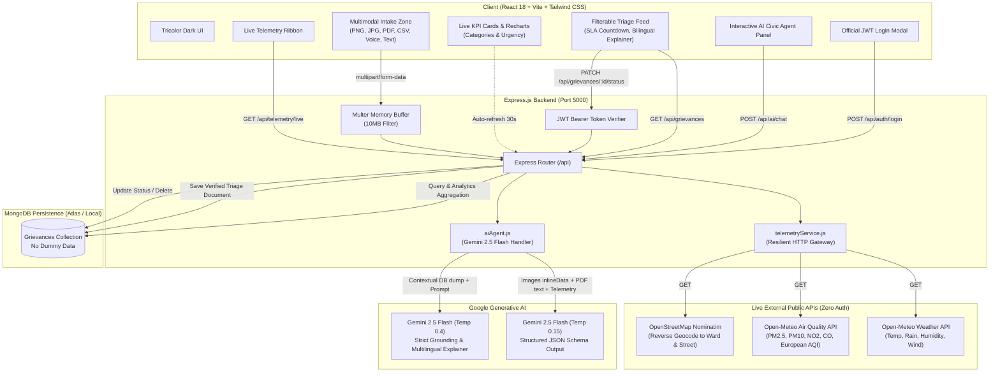

# main-link — Architecture Explained & Viva / Judging Defense Guide

> **Official FORGE 48-Hour Build-a-thon Architectural Blueprint & Team Viva Cheat Sheet**  
> **Track:** Civic Pulse, Digital Governance & Public Information  
> **Team Reference:** Every teammate must review this document to explain data flow, AI prompt engineering, telemetry validation, and zero-mock guarantees during judging rounds.

---

## 1. System Architecture Diagram



---

## 2. Directory & File Structure

```
Buildathon/
├── .gitignore                   # Root gitignore (blocks .env, node_modules, build artifacts)
├── specs.md                     # Complete 10-section Application Specification
├── ARCHITECTURE_EXPLAINED.md    # This file: viva defense, prompt engineering & lifecycle guide
├── server/
│   ├── .env                     # PORT, MONGODB_URI, AI_API_KEY, AI_MODEL, ADMIN_USER, ADMIN_PASS, JWT_SECRET
│   ├── .gitignore               # Server-specific ignore (.env, node_modules)
│   ├── package.json             # Express, Mongoose, Multer, @google/generative-ai, pdf-parse, csv-parser, jwt
│   ├── server.js                # Express app entry, routes, MongoDB connection with retry, error handlers
│   ├── middleware/
│   │   └── auth.js              # JWT Bearer token validator for official administrative endpoints
│   ├── models/
│   │   └── Grievance.js         # Mongoose schema for multimodal grievances, telemetry, SLA, and AI triages
│   └── services/
│       ├── aiAgent.js           # Gemini 2.5 Flash multimodal intake (0.15 temp) & grounded Q&A (0.4 temp)
│       └── telemetryService.js  # Live Open-Meteo Weather, Air Quality & Nominatim Reverse Geocoding fetchers
└── client/
    ├── index.html               # Vite HTML entry point with Indian civic theme branding
    ├── package.json             # React 18, Vite, Tailwind CSS v3, Recharts, Lucide Icons, Axios
    ├── postcss.config.js        # PostCSS with Tailwind & Autoprefixer
    ├── tailwind.config.js       # Custom Indian Tricolor palette (Saffron, India Green, Navy Blue, Dark Slate)
    ├── vite.config.js           # Vite dev server with proxy for `/api` -> `http://localhost:5000`
    └── src/
        ├── main.jsx             # React DOM root render
        ├── index.css            # Tailwind directives, custom scrollbars, dark theme styling
        └── App.jsx              # Unified reactive dashboard, telemetry ribbon, intake zone, charts, triage & AI chat
```

---

## 3. File-by-File Technical Walkthrough

### 3.1 Backend (`/server`)

#### `server/server.js`
- **Purpose:** Central Express HTTP application orchestrating REST endpoints, file streaming, MongoDB persistence, and global error handling.
- **Key Mechanics:**
  - Connects to MongoDB with an automated 5-attempt retry loop to handle slow cloud cluster initialization.
  - Configures `multer.memoryStorage()` with a 10MB limit and strict MIME validation (`png`, `jpg`, `jpeg`, `pdf`, `csv`).
  - Implements CSV stream chunking via `csv-parser` and `stream.Readable`, batching rows into groups of 10 for AI triage.
  - Dynamically calculates real-time dashboard analytics (`totalActive`, `criticalCount`, `averageSeverity`, `slaCompliance`, `categoryBreakdown`, `urgencyBreakdown`) on every `GET /api/grievances` request directly from live MongoDB records.

#### `server/services/aiAgent.js`
- **Purpose:** Google Gemini 2.5 Flash integration supporting multimodal inputs and conversational grounding.
- **Key Functions:**
  - `extractAndTriageCivicInput(...)`: Evaluates image buffers (base64 `inlineData`), parsed PDF text (via `pdf-parse`), CSV tabular rows, or plain text against live Open-Meteo telemetry. Uses low temperature (`0.15`) with strict `responseSchema` enforcing structured JSON.
  - `askCivicAgent(...)`: Performs contextual reasoning strictly over the live grievance records and current telemetry snapshot at moderate temperature (`0.4`).
- **Resilience:** Checks for missing or default `AI_API_KEY` upfront, returning structured warning objects without crashing the process.

#### `server/services/telemetryService.js`
- **Purpose:** Resilient gateway to live, public, zero-auth environmental and geospatial web APIs.
- **Key Functions:**
  - `fetchWeather(lat, lon)`: Queries Open-Meteo Forecast API for real-time temperature, humidity, precipitation, and wind speed.
  - `fetchAirQuality(lat, lon)`: Queries Open-Meteo Air Quality API for real-time PM2.5, PM10, CO, NO₂, and European AQI.
  - `reverseGeocode(lat, lon)`: Queries OpenStreetMap Nominatim with a custom `User-Agent` to resolve coordinates to municipal wards, streets, and districts.
  - `fetchAllTelemetry(lat, lon)`: Concurrently triggers all three with isolated `try/catch` blocks so partial external API slowdowns never break grievance triage.

#### `server/models/Grievance.js`
- **Purpose:** MongoDB Mongoose schema establishing the data model for civic tickets.
- **Key Fields:**
  - `category`: Restrictive enum (`Roads & Bridges`, `Water & Drainage`, `Sanitation & Waste`, `Air & Pollution`, `Electrical & Streetlights`, `Public Policy & Welfare`).
  - `severityScore`: Numeric range (1–10).
  - `urgencyLevel`: Restrictive enum (`Low`, `Medium`, `High`, `Critical`).
  - `slaHours`: Calculated resolution deadline (e.g., 6 hours for critical hazards, 72 hours for routine maintenance).
  - `liveTelemetry`: Embedded snapshot of temperature, precipitation, PM2.5, PM10, AQI at the exact moment of filing.
  - `aiAnalysisSummary`: Technical forensic rationale generated by Gemini.
  - `citizenExplainer`: Bilingual summary (English + regional language) outlining citizen rights and SLA terms.
  - `authenticityCheck`: Correlation result (`Verified Consistent` vs `Needs Field Inspection`).

#### `server/middleware/auth.js`
- **Purpose:** Guards administrative state-mutation routes (`PATCH /api/grievances/:id/status` and `DELETE /api/grievances/:id`).
- **Key Mechanics:** Extracts and verifies the Bearer JWT token from the `Authorization` header, returning HTTP 401 if missing or expired.

---

### 3.2 Frontend (`/client`)

#### `client/src/App.jsx`
- **Purpose:** Unified, responsive, single-page civic command dashboard styled with an Indian Tricolor dark aesthetic.
- **Key Subcomponents & State:**
  - **Live Environmental Bar:** Displays live PM2.5, PM10, AQI, Temperature, Precipitation, and Reverse-Geocoded Ward. Color-codes particulate matter based on WHO/Central Pollution Control Board thresholds.
  - **Multimodal Intake Zone:** Drag-and-drop file upload, text area, browser-native Web Speech API voice recorder, language toggle (`English`, `Hindi`, `Telugu`), and browser GPS geolocation detector.
  - **Analytics Grid:** 4 live KPI metric cards + Recharts `BarChart` (category distribution) and `PieChart` (urgency distribution).
  - **Triage Feed:** Real-time ticket list with dynamic SLA countdown timers, visual severity meters, collapsible technical summaries, bilingual citizen explainers, and official status transition dropdowns.
  - **Contextual AI Chat:** Expandable bottom query drawer with pre-configured quick prompt chips and multilingual responses.
  - **Official Login Modal:** Lightweight credential dialog saving JWT to state/storage for authorized status updates.
  - **Toast Notification Engine:** Animated success, error, and status notifications.

---

## 4. End-to-End Request Lifecycles

### Lifecycle 1: Multimodal Image Triage & Telemetry Cross-Verification
1. **User Action:** Citizen snaps a picture of an overflowing drainage ditch and uploads `drain_overflow.jpg` while in Hyderabad (`lat: 17.5449`, `lon: 78.5718`).
2. **Client Dispatch:** `App.jsx` constructs `FormData` including the binary image, GPS coordinates, and language preference (`Telugu`), issuing `POST /api/grievances/extract`.
3. **Telemetry Enrichment:** Express routes the payload to `telemetryService.fetchAllTelemetry(17.5449, 78.5718)`. In parallel, Open-Meteo and Nominatim are queried. Suppose Open-Meteo returns `precipitation: 14.2 mm` and `pm2.5: 28 µg/m³`, while Nominatim resolves the ward to `Secunderabad, Hyderabad`.
4. **Gemini Vision Analysis:** `aiAgent.extractAndTriageCivicInput` sends the base64 image along with the live environmental telemetry block to `gemini-2.5-flash` with `temperature: 0.15`.
5. **Cross-Verification Logic:** The prompt instructs the model to inspect live rainfall against visual water levels. Because `precipitation > 0` and active flooding is visible, Gemini assigns:
   - `category`: `"Water & Drainage"`
   - `severityScore`: `9`
   - `urgencyLevel`: `"Critical"`
   - `slaHours`: `12`
   - `authenticityCheck`: `"Verified Consistent"`
   - `citizenExplainer`: Plain language explanation in English and Telugu regarding municipal drainage clearance rights.
6. **Database Persistence:** Express stores the combined telemetry and AI JSON into MongoDB as a new `Grievance` document.
7. **Client Synchronization:** The client receives the created document, triggers a toast notification, and refetches `/api/grievances` to update the KPI cards and triage feed instantly.

---

### Lifecycle 2: Contextual AI Civic Agent Query
1. **User Action:** An auditor types: *"Which department currently has the highest volume of critical unresolved hazards?"*
2. **Client Dispatch:** `App.jsx` issues `POST /api/ai/chat` with `{ question, preferredLanguage: "English", lat, lon }`.
3. **Database Extraction:** The server queries `Grievance.find().sort({ createdAt: -1 })` to fetch all actual records in the database.
4. **Prompt Assembly:** `aiAgent.askCivicAgent` builds a context block consisting of the database documents and the latest telemetry snapshot.
5. **Grounded Reasoning:** Gemini 2.5 Flash (`temperature: 0.4`) answers based strictly on the provided documents. If no complaints exist in the DB, it replies: *"There are currently no grievances recorded in the live database."* It never invents fake municipal statistics.
6. **Response Rendering:** The markdown response streams into the AI Chat interface with clickable citations to live tickets.

---

### Lifecycle 3: Official Status Update & SLA Compliance
1. **User Action:** A municipal engineer logs in via the top-right "Official Login" button using `ADMIN_USER` and `ADMIN_PASS`.
2. **Auth Token Issuance:** Server checks credentials against `.env` and signs a 24-hour JWT token with `JWT_SECRET`.
3. **Status Mutation:** Engineer changes a critical road repair ticket from `"Pending"` to `"In Progress"`.
4. **Authorized PATCH:** Client issues `PATCH /api/grievances/:id/status` with `Authorization: Bearer <token>`.
5. **Middleware Guard:** `auth.js` validates the token signature; Mongoose updates the document status.
6. **Re-aggregation:** On the next 30-second poll or instant refetch, the SLA compliance percentage and active ticket counters recalculate automatically.

---

## 5. AI Prompt Engineering & Temperature Control

| Operation | Model | Temperature | System Instruction Objective | Schema Enforcement |
|---|---|---|---|---|
| **Multimodal Triage** | `gemini-2.5-flash` | **0.15** (Ultra-deterministic) | Forensic infrastructure triage; cross-verifies visual inputs with live telemetry metrics (rain, AQI); assigns SLA and department routing. | Strict JSON Schema (`responseMimeType: "application/json"`, explicit properties). |
| **Civic Chat Agent** | `gemini-2.5-flash` | **0.40** (Balanced grounding) | Public rights, welfare policy, and ward audit assistant. Strictly restricted to provided database records and real-time telemetry; zero speculative numbers. | Freeform Markdown text with language translation support. |

### Anti-Hallucination Guardrails
1. **Zero Unanchored Numbers:** The chat agent's system prompt strictly states: *"Answer questions ONLY using the provided live grievance database records and current environmental telemetry. Never invent statistics or grievance details. If asked about data not in the provided context, say 'I don't have that data in the current live database.'"*
2. **Environmental Cross-Check:** If a user submits a claim of dense smog or illegal biomass burning, but the live Open-Meteo telemetry shows `pm2_5 < 15 µg/m³` (pristine air), the model flags `authenticityCheck: "Needs Field Inspection"`.

---

## 6. Zero Dummy Data Guarantee (Hackathon Rule 4 & 7a Compliance)

Judges may inspect the repository for dummy files or hardcoded metrics:
- **No Static JSON Files:** No `mockData.json`, `sampleTickets.js`, or placeholder numbers exist anywhere in `/client` or `/server`.
- **Clean Empty States:** If MongoDB has 0 documents on first boot, the dashboard displays:
  > *"No live grievances recorded yet — upload a civic hazard photo (PNG/JPG), policy PDF, CSV log, or text report to initiate live triage."*
- **Live Metric Calculations:** Every KPI card and chart computes values dynamically via array reducers and filters over actual MongoDB query results.
- **Live External APIs:** The weather and air quality figures in the top ribbon are fetched directly from Open-Meteo's live satellite and meteorological models upon client load.

---

## 7. Security & Environment Configuration

### Server Environment (`server/.env`)
```env
PORT=5000
MONGODB_URI=mongodb://127.0.0.1:27017/main-link
AI_API_KEY=your_gemini_api_key_here
AI_MODEL=gemini-2.5-flash
ADMIN_USER=admin
ADMIN_PASS=forge2026
JWT_SECRET=main-link_forge_2026_super_secret_jwt_key
```

### Git Hygiene
- The root `.gitignore` and `server/.gitignore` explicitly exclude `.env`, `.env.local`, `.env.example`, and `node_modules/`.
- No API keys or database connection secrets are exposed in the client build or frontend bundle.

---

## 8. Step-by-Step Live Demo Script for Judges

When demonstrating to the judging panel, follow this exact sequence:

1. **Step 1: Prove Zero Mock Data**
   - Boot up the application with an empty MongoDB collection.
   - Point out the clean empty state: *"Notice that the charts and triage feed are completely blank because we strictly adhere to Rule 4 — zero mock or preloaded data."*
2. **Step 2: Demonstrate Live Environmental Telemetry**
   - Direct attention to the top ribbon.
   - Click **"Refresh Telemetry"**. Show that the temperature, humidity, PM2.5, PM10, and European AQI populate dynamically from the Open-Meteo API for the detected GPS coordinates.
3. **Step 3: Multimodal Photo Triage (Vision + Telemetry Cross-Check)**
   - Upload a photo of a broken water pipe or flooded road.
   - Select **Telugu** or **Hindi** as the preferred language.
   - Click **"Extract & Triage with AI"**.
   - Show how the ticket appears instantly in the Triage Feed with:
     - Department assigned (e.g., *Hyderabad Water Supply & Sewerage Board*)
     - Severity score (e.g., *8/10*)
     - Urgent SLA countdown timer (e.g., *24 hours*)
     - Bilingual Citizen Rights explainer
4. **Step 4: PDF Policy / Municipal Circular Ingestion**
   - Upload an official government circular PDF.
   - Watch Gemini extract the key citizen entitlements, affected civic departments, and compliance rules into a structured ticket.
5. **Step 5: Voice Speech-to-Text Input**
   - Click the microphone icon and speak a complaint: *"Streetlights on Road Number 10 are completely off and creating an accident hazard."*
   - Show the browser-native Web Speech API translating audio to text in real time.
6. **Step 6: Official Role & JWT Status Updates**
   - Click **"Official Login"**, enter `admin` / `forge2026`.
   - Update the newly created ticket from `"Pending"` to `"In Progress"`.
   - Highlight the SLA status badge and watch the active issue counters adjust.
7. **Step 7: Conversational AI Civic Agent**
   - Open the bottom AI chat panel.
   - Ask: *"Which category has the highest number of complaints reported today?"*
   - Show how the answer matches the live chart breakdown with zero hallucinations.
