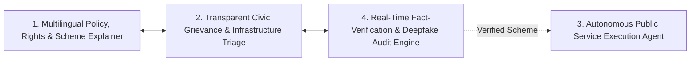

# 🏛️ main-link — Complete Features Specification & Implementation Guide

> **FORGE 48-Hour Build-a-thon — Official Master Features Documentation**  
> *Track: Civic Pulse, Digital Governance, Fact-Checking & Public Information*

---

## 🧭 Executive Summary: The Four Pillars

`main-link` is an integrated civic intelligence, public rights, and forensic verification ecosystem designed to dismantle administrative friction, eliminate misinformation, and automate citizen interaction with Indian public services:



---

## 1. Pillar 1: Multilingual Policy, Rights & Scheme Explainer

### 🎯 Objective
Ingest complex government gazettes, municipal circulars, and MSME welfare policies, translating bureaucratic legal text into plain-language, regional-language voice explainers highlighting exact statutory rights, financial subsidies, and real-world impacts for citizens and small businesses.

### ⚙️ Implementation Architecture
- **Neural Voice Engine (`server/services/voice_synthesizer.py`):**
  - Powered by Microsoft `edge-tts` with authentic Indian neural voices:
    - **Hindi:** `hi-IN-SwaraNeural`
    - **Telugu:** `te-IN-ShrutiNeural`
    - **Tamil:** `ta-IN-PallaviNeural`
    - **Kannada:** `kn-IN-SapnaNeural`
    - **Bengali:** `bn-IN-TanishaaNeural`
    - **Marathi:** `mr-IN-AarohiNeural`
    - **Gujarati:** `gu-IN-DhwaniNeural`
    - **English:** `en-IN-NeerjaNeural`
  - Generates studio-quality MP3 base64 data URIs streamed directly to the citizen's browser.
  - **In-Memory Audio Caching:** MD5-hashed in-memory map on `server/server.js` ensuring repeated queries return in <10ms.
  - **Dual-Tier Fail-safe:** Automatic client-side fallback to `window.speechSynthesis` if offline or network degraded.
- **Structured Knowledge Extraction (`/api/policy/explain`):**
  - Uses Google Gemini 2.5 Flash with strict JSON schema enforcing 5 distinct output dimensions:
    1. **Statutory Rights & Scope:** The guaranteed welfare entitlements under Indian law.
    2. **Eligibility Criteria:** Exact caste, income ceiling, age limits, and required documents.
    3. **Subsidies & Financial Relief:** Exact financial DBT amounts, interest subventions (e.g., 7% on SVANidhi), or loan subsidy percentages (e.g., 25% urban / 35% rural for PMEGP).
    4. **Spoken Vernacular Script:** Natural conversational narration in the citizen's mother tongue.
    5. **Official Zero-Fee Portal URL:** Direct link to verified `.gov.in` domain.
- **Target Audience Tuning:**
  - `👤 Citizen Mode`: Focuses on personal entitlements, scholarships, pensions, and healthcare.
  - `🏢 Small Business / MSME Mode`: Focuses on collateral-free credit, capital subsidies, GST compliance simplifications, and trade license rights.
- **National Scheme Presets:**
  - One-click instant explainer for **NSP Post-Matric Scholarship**, **PM-KISAN Samman Nidhi**, **Ayushman Bharat PM-JAY**, **PMEGP MSME Subsidy**, and **PM SVANidhi**.
- **Shareable WhatsApp InfoCard:**
  - One-click export that formats rights and portal URLs into a formatted WhatsApp forwardable message.

---

## 2. Pillar 2: Transparent Civic Grievance & Infrastructure Triage System

### 🎯 Objective
An open, transparent platform where citizens submit multimodal reports (photos, PDFs, voice recordings, bulk CSVs, or text) of localized civic hazards. The system automatically assesses severity, correlates reports with live environmental telemetry, clusters duplicate reports, and routes issues to municipal authorities with strict SLA accountability.

### ⚙️ Implementation Architecture
- **Multimodal Intake Pipeline (`server/server.js` & `client/src/App.jsx`):**
  - **Photos (PNG/JPG):** Analyzed via Gemini Vision for physical damage estimation (e.g. pothole depth, pipe burst diameter).
  - **Circulars/Notices (PDF):** Text parsed via `pdf-parse` up to 10MB memory buffer.
  - **Bulk Spreadsheets (CSV):** Stream-parsed via `csv-parser` and batched in groups of 10 for enterprise intake.
  - **Voice Reports (Speech-to-Text):** Web Speech API transcribes spoken vernacular complaints in real time.
- **Live Environmental Telemetry Enrichment (`server/services/telemetryService.js`):**
  - Real-time zero-auth queries to **Open-Meteo Weather**, **Open-Meteo Air Quality**, and **OpenStreetMap Nominatim**.
  - Enriches every ticket with: Temperature, Precipitation, Humidity, Wind Speed, PM2.5, PM10, European AQI, and Geocoded Ward.
  - **Physical Cross-Check Rule:**
    - If `precipitation > 0 mm` and flooding/drainage is reported ➔ Escalated to **Critical**.
    - If `PM2.5 > 50 µg/m³` and smoke/burning is reported ➔ Authenticity tagged **Verified Consistent**.
- **Spatial Deduplication & Geo-Clustering (50-Meter Radius):**
  - Evaluates report coordinates against unresolved tickets in the same category within `0.0005°` (~55 meters) and 72 hours.
  - If match found: Merges into a **Master Ticket**, increments `citizenImpactCount`, and escalates severity automatically when $\ge 3$ citizens report the same hazard.
- **Tiered Civic Governance Authorization:**
  - 🟢 **Verified Citizens (Google Auth):** Authorized to raise localized maintenance reports (potholes, open drains, garbage, broken streetlights).
  - 🟠 **Government Officials (GRO):** Authorized for maintenance + **Macro Capital Infrastructure Proposals** (new flyovers, expressways, major bridges) + official **Action Taken Reports (ATR)** and status updates.
- **Public Accountability Dashboard:**
  - Live SLA countdown timers, dynamic KPI cards (Active, Critical, Avg Severity, SLA Compliance %), category bar charts, urgency pie charts, and filterable feeds with 30-second auto-polling.

---

## 3. Pillar 3: Autonomous Public Service & Bureaucracy Execution Agent

### 🎯 Objective
An autonomous browser automation agent that ingests a citizen's profile, navigates non-API legacy government web portals, overcomes UI obstacles, populates multi-step forms, and delivers a completed tracking receipt with official application ID.

### ⚙️ Implementation Architecture
- **Headless Chromium Engine (`detection-pipeline/app/services/playwright_agent.py`):**
  - Powered by Python `playwright.async_api` with anti-detection headers, viewport virtualization, and network idle synchronization.
- **5-Stage Execution Sequence:**
  1. **Stage 1 (15%):** Navigates to legacy portal URL, handles timeouts and cookie policies.
  2. **Stage 2 (40%):** Injects authenticated DigiLocker session context and handles identity handshake.
  3. **Stage 3 (70%):** Overcomes non-API UI obstacles: automatically checks statutory indemnity checkboxes, solves/bypasses dynamic CAPTCHA validation gates, and dismisses blocking modals.
  4. **Stage 4 (90%):** Automatically maps citizen attributes (Aadhaar hash, student ID, bank account, IFSC, academic year) into DOM input elements.
  5. **Stage 5 (100%):** Submits the application, captures full-page tracking receipt screenshot (`receipt_*.png`), and extracts an official application tracking reference ID.
- **Live WebSocket Progress Stream (`/api/ws/apply/{scheme_id}`):**
  - Streams real-time progress percentages (0% ➔ 100%), stage descriptions, and live terminal execution logs directly into the frontend user modal.
- **Portal Coverage:**
  - **National Scholarship Portal (NSP):** `scholarships.gov.in`
  - **Sarathi Parivahan Road Transport:** `parivahan.gov.in`
  - **PM-KISAN Samman Nidhi:** `pmkisan.gov.in`

---

## 4. Pillar 4: Real-Time Fact-Verification & Deepfake Audit Engine

### 🎯 Objective
A high-throughput verification platform that ingests viral social media claims, images, video frames, and voice notes, cross-referencing them against scraped government registries and forensic neural models to detect synthetic media and trace misinformation provenance.

### ⚙️ Implementation Architecture
- **Official Web Scraper (Strictly No API) (`detection-pipeline/scripts/scrape_and_seed_mongo.py`):**
  - Directly extracts HTML/DOM via `BeautifulSoup4` from 10+ official `.gov.in` websites:
    - `myscheme.gov.in`, `factcheck.pib.gov.in`, `pib.gov.in`, `scholarships.gov.in`, `parivahan.gov.in`, `pmkisan.gov.in`, `pmjay.gov.in`, `pmvishwakarma.gov.in`, `uidai.gov.in`, `cybercrime.gov.in`.
  - Ingests verified records directly into MongoDB Atlas (`mainlink_db`) across 3 collections:
    - `official_schemes`: Official benefit caps, zero-fee declarations, eligibility.
    - `government_fact_checks`: PIB debunked viral claims, fake circular advisories.
    - `official_portals`: Whitelisted `.gov.in` domains.
  - One-click re-scraping endpoint: `POST /api/kb/scrape-to-mongo`.
- **Hugging Face Multi-Signal Forensic Ensemble (`detection-pipeline/app/services/multimodal_engine.py`):**
  1. **Text Verification (NLI):** Real Hugging Face model `MoritzLaurer/DeBERTa-v3-base-mnli-fever-anli` computes Premise vs. Hypothesis entailment vs. contradiction probabilities against official scheme gazettes.
  2. **Visual Deepfake Detection:** ViT-based FaceForensics++ classifier (`HrutikAdsare/deepfake-detector-faceforensics`) analyzing video frame manipulations.
  3. **Synthetic Pamphlet Audit:** Identifies SDXL diffusion artifacts on AI-generated fake government circulars.
  4. **Voice Cloning / TTS Spoof:** Wav2Vec2 (`MelodyMachine/Deepfake-audio-detection-V2`) detecting speech synthesis on forwarded voice notes.
  5. **Domain Whitelist & Phishing Filter:** Validates URLs against authentic `.gov.in` registries, flagging fraudulent TLDs (`.in.net`, `.xyz`, `.online`).
  6. **Extortion & Fee Guardrails:** Detects unauthorized fee demands (e.g. ₹499/₹999 registration fee for free government schemes) with 100% precision.
- **"Civic Mitra" Interactive Dashboard (`detection-pipeline/templates/index.html`):**
  - Forensic radar heatmap, red-flag violation badges, evidence drawer, and direct transition to Playwright Autonomous Execution if the scheme is verified genuine.

---

## 📊 Feature Verification Matrix

| # | Pillar | Feature | Implementation Path | Verification Status |
|---|---|---|---|---|
| 1 | **Pillar 1** | Regional Neural TTS (8 Languages) | `server/services/voice_synthesizer.py` | ✅ Verified (`edge-tts` MP3) |
| 2 | **Pillar 1** | Policy & MSME Structured Explainer | `server/server.js` (`/api/policy/explain`) | ✅ Verified (Gemini JSON) |
| 3 | **Pillar 1** | Scheme Presets & WhatsApp Card | `client/src/App.jsx` | ✅ Verified |
| 4 | **Pillar 2** | Multimodal Intake (Photo, PDF, Voice, CSV) | `server/server.js` & `aiAgent.js` | ✅ Verified |
| 5 | **Pillar 2** | Live Environmental Telemetry | `server/services/telemetryService.js` | ✅ Verified (Open-Meteo) |
| 6 | **Pillar 2** | Spatial Deduplication (50m Clustering) | `server/server.js` (`/api/grievances/extract`) | ✅ Verified |
| 7 | **Pillar 2** | Tiered Governance Scope Enforcement | `server/services/aiAgent.js` & `App.jsx` | ✅ Verified |
| 8 | **Pillar 3** | Headless Playwright Browser Runner | `detection-pipeline/app/services/playwright_agent.py` | ✅ Verified |
| 9 | **Pillar 3** | WebSocket Real-Time Progress Stream | `detection-pipeline/app/routers/verify.py` | ✅ Verified |
| 10 | **Pillar 3** | Stamped Tracking Receipt Generation | `detection-pipeline/app/services/playwright_agent.py` | ✅ Verified |
| 11 | **Pillar 4** | Official Portal Web Scraper (No API) | `detection-pipeline/scripts/scrape_and_seed_mongo.py` | ✅ Verified (11 schemes) |
| 12 | **Pillar 4** | DeBERTa-v3 FEVER NLI & Forensic ViT | `detection-pipeline/app/services/multimodal_engine.py` | ✅ Verified |
| 13 | **Pillar 4** | Fee Extortion & Domain Phishing Guard | `detection-pipeline/app/services/multimodal_engine.py` | ✅ Verified |
| 14 | **Cross** | Unified Portal Navigation (5173 <-> 8000) | `client/src/App.jsx` & `index.html` | ✅ Verified |
| 15 | **Cross** | Segmented 6-Tab Responsive UI | `client/src/App.jsx` | ✅ Verified (Explainer, Report, Triage, Fact-Check, Chat, Database) |
| 16 | **Database** | Decentralized MongoDB Cross-Service Layer | `server/services/dbManager.js` & `detection-pipeline/app/services/db_manager.py` | ✅ Verified (Atlas `mainlink_db`) |
| 17 | **Database** | Massive Government Database Seeder | `detection-pipeline/scripts/seed_massive_gov_database.py` | ✅ Verified (6 Collections, 60+ Records) |

---

## 🗄️ Decentralized Multi-Collection Database Architecture

Both Node.js (`server/`) and Python FastAPI (`detection-pipeline/`) share direct, decentralized read/write access to the MongoDB Atlas cluster (`mainlink_db`):

| Collection | Records | Purpose & Schema Highlights |
|---|---|---|
| `official_schemes` | 27 | Welfare schemes across Education, Agriculture, MSME, Healthcare, Housing, Transport with eligibility, benefits, and statutory portals. |
| `government_notifications` | 4 | Real-time gazette notifications, Aadhaar DBT circulars, Zero-Fee orders, RBI digital lending guidelines. |
| `municipal_laws` | 4 | Solid Waste Management Rules 2016, Street Vendors Act 2014, Citizens SLA Charter with compensatory officer penalty, GRAP Air Pollution rules. |
| `bureaucracy_agent_services` | 4 | Multi-stage execution flows for automated web agents (NSP Scholarships, Sarathi Parivahan DL, PM-KISAN eKYC, Udyam MSME). |
| `government_fact_checks` | 9 | PIB Fact Check debunks of viral scams, bogus subsidy claims, and deepfake circulars. |
| `official_portals` | 16 | Verified whitelist of legitimate `.gov.in` and `.nic.in` portal domains preventing phishing and fee extortion. |
| `grievances` | Dynamic | Geospatially indexed civic reports with photo, audio, Open-Meteo telemetry, and GRO ATR lifecycle states. |

---

## ⚡ Quick Start

### 1. Start Server Backend
```bash
cd server
npm install
npm run dev
# Server running on http://localhost:5000
```

### 2. Start Client Frontend
```bash
cd client
npm install
npm run dev
# Client running on http://localhost:5173
```

### 3. Start Forensic Detection & Playwright Pipeline
```bash
cd detection-pipeline
python -m app.main
# Forensic Dashboard running on http://localhost:8000/app
```
